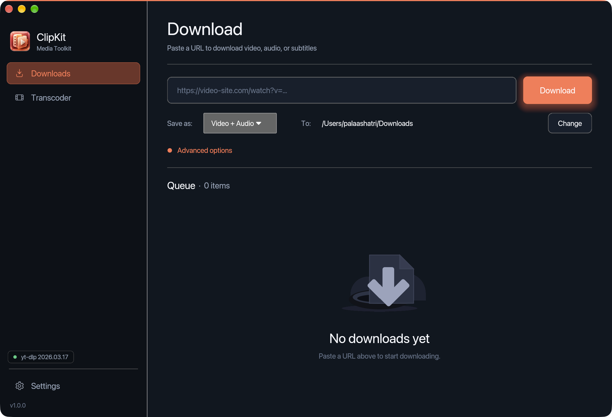
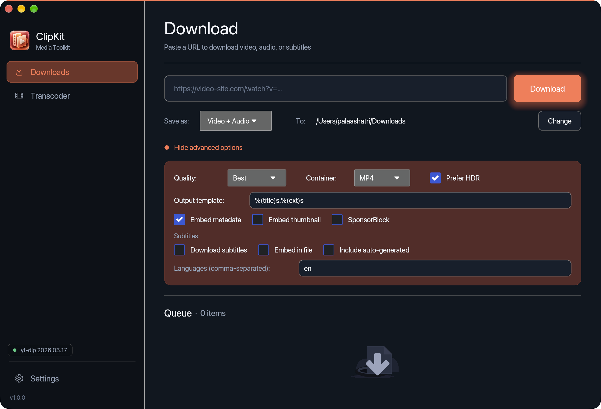
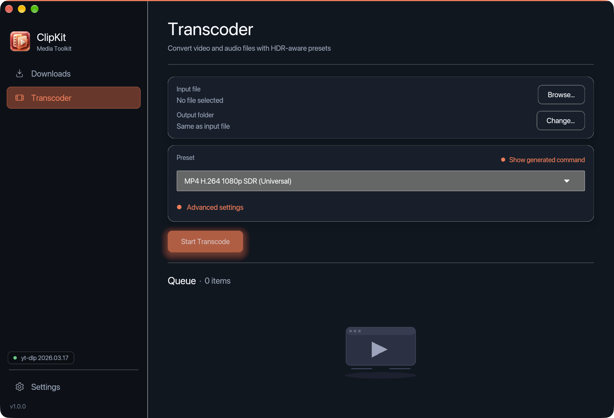
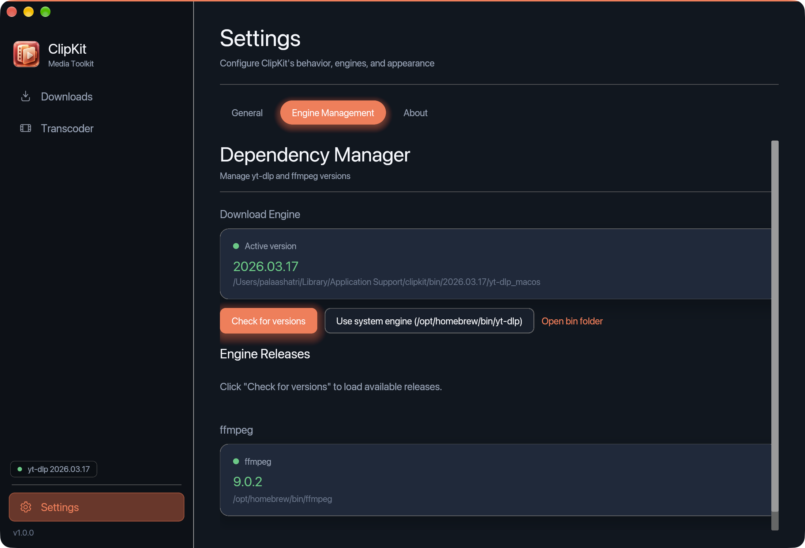
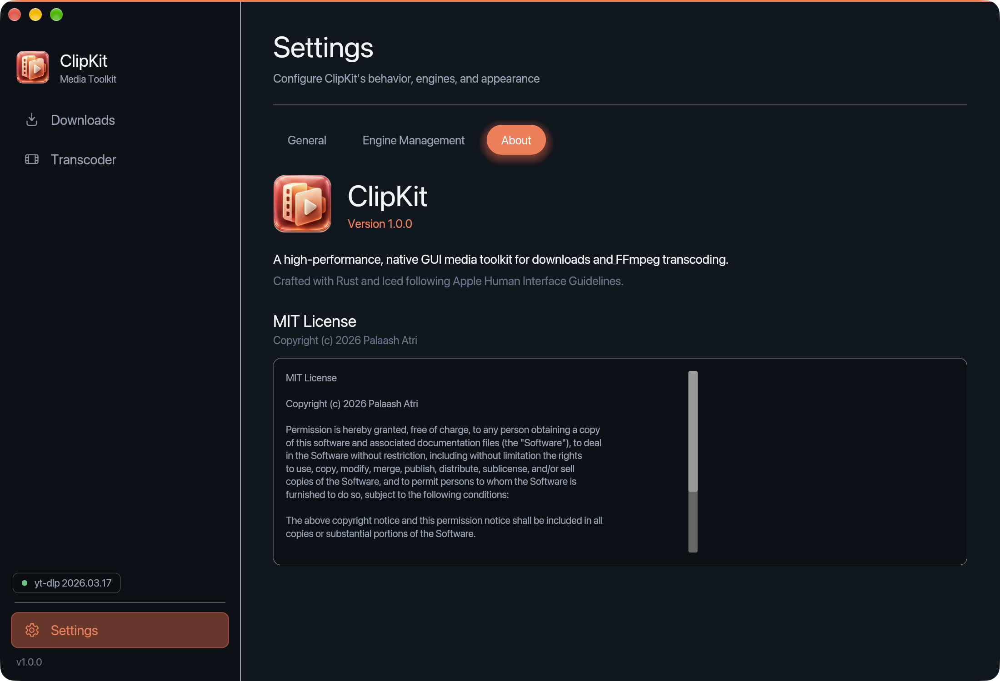
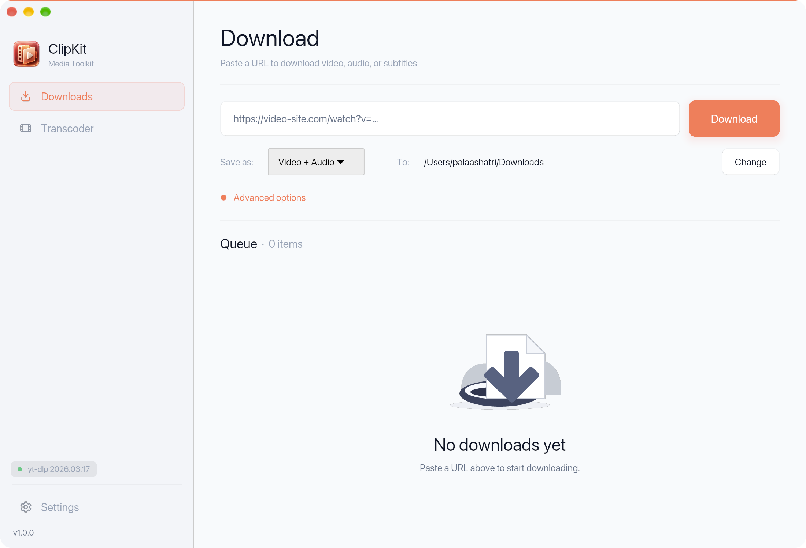

# ClipKit

A high-performance, native GUI media toolkit for downloads and FFmpeg transcoding — built in Rust with [Iced](https://github.com/iced-rs/iced) 0.12 and Tokio, aligned with Apple Human Interface Guidelines.



## Screenshots & Interface Tour

| Download Workspace (Dark) | Advanced Download Options |
|:---:|:---:|
|  |  |

| HDR-Aware Transcoder | Engine & FFmpeg Management |
|:---:|:---:|
|  |  |

| About & Identity Showcase | Ceramic Light Theme |
|:---:|:---:|
|  |  |

*For full details on every screen and control, see the [Interface & Visual Tour](docs/SCREENSHOTS.md).*

## Features

- **Simple & advanced download modes** — paste a URL and press Enter, or tune quality, subtitles, metadata, and SponsorBlock.
- **Engine version manager** — fetch, download, and activate releases with cryptographic SHA-256 checksum verification; or use a system-installed binary.
- **Download queue** — multiple concurrent downloads with real-time progress, speed, and ETA.
- **Transcoder** — convert downloaded files via FFmpeg with built-in presets and HDR-aware options (tone-map to SDR, preserve HDR/DV metadata).
- **Settings & live theme switching** — configure paths, theme (Dark / Ceramic Light), GPU acceleration, and engine versions.
- **Apple HIG-aligned UI** — native macOS menubar with Cocoa activation, traffic-light inset spacing, and 3D sculpted coral icon identity.

## Status

- **CI/CD:** Automated CI on push and PR with `fmt`, `clippy -D warnings`, test suites, and Linux builds.
- **Security:** Engine updater validates SHA-256 sums against official release `SHA2-256SUMS` before marking binaries executable.
- **Design & UI/UX:** Coordinated 3D brand identity with native macOS menubar, window icons, and Apple HIG-aligned themes.
- **Reproducibility:** `Cargo.lock` committed with locked dependency resolution.

## Roadmap

In priority order — each is something a user would notice:

1. **Downloadable releases & CI** for Windows, macOS, and Linux.
2. [x] **Safe engine updates:** verify downloaded engine binaries against release SHA-256 sums before running them.
3. [x] **Redesigned UI/UX:** tactile coral palette, native menubar, sculpted 3D application icons.
4. **Pick a quality before downloading:** list the formats a URL offers (resolution, codec, size) and let the user choose, instead of typing a format string.
5. **Playlists and channels:** expand a playlist into individual queue items with select/deselect.
6. **A queue that survives restarts**, with retry for failed items.
7. **Clipboard detection:** offer to queue a supported URL when one is copied.

## Prerequisites

### Build tools
- [Rust stable toolchain](https://rustup.rs/) (edition 2021, 1.70+)
- A C linker (MSVC on Windows, Xcode CLT on macOS, `gcc` on Linux)

### Runtime tools
- **Download Engine** — ClipKit can download and manage it for you from the *Engine Management* tab in Settings. Alternatively install it manually and use "Use system engine".
- **ffmpeg** — required for transcoding only. Install from [ffmpeg.org](https://ffmpeg.org/download.html) and make sure it is on your `PATH`, or point the app to its location in Settings.

## Building

The quickest way to build and launch is with the provided scripts:

```bat
# Windows
scripts\build.bat
```

```bash
# macOS / Linux
chmod +x scripts/build.sh && ./scripts/build.sh
```

Or build manually:

```bash
# Debug build (fast to compile)
cargo build

# Release build (optimised, smaller binary)
cargo build --release -p gui
```

The compiled binary lives at `target/release/clipkit` (or `clipkit.exe` on Windows).

> **Windows note:** If you are on a machine with an Application Control policy (e.g. corporate Windows), Cargo's
> build scripts may be blocked when run from user-writable directories. The `build.bat` script handles this
> automatically by using `C:\ProgramData\clipkit-build` as the output directory. To do the same manually:
> ```powershell
> $env:CARGO_TARGET_DIR = "C:\ProgramData\clipkit-build"
> cargo build --release -p gui
> # Binary: C:\ProgramData\clipkit-build\release\clipkit.exe
> ```

## Running

```bash
cargo run --release -p gui
```

Or run the binary directly after building.

## First run

1. Go to the **Settings** pane and select the **Engine Management** tab.
2. Click **Check for versions** to load the release list.
3. Click **Download & activate** on the desired release — ClipKit downloads the correct binary for your OS.
4. Switch to the **Download** pane, paste a URL, and click **Download**.

If ffmpeg is installed, it will be detected automatically on startup; otherwise a warning appears in the **Transcoder** pane and you can set the path in **Settings**.

## Project layout

```
crates/
  core/             # Config, models (DownloadJob, TranscodeJob, …), presets
  yt_dlp_backend/   # GitHub release fetcher, binary downloader, engine process manager
  transcoder/       # ffmpeg detection and transcode engine (HDR/DV handling)
  gui/              # Iced application — all panes and app state
```

## Architecture notes

- All heavy work (process I/O, HTTP) runs inside Tokio tasks.
- Events flow from background tasks → `tokio::sync::broadcast` channel → Iced subscription → UI messages. The UI thread is never blocked.
- Config is persisted to the platform-appropriate directory (`%APPDATA%\clipkit` on Windows, `~/.config/clipkit` on Linux/macOS).
- Engine binaries are stored in `%LOCALAPPDATA%\clipkit\bin\<version>\` (Windows) or `~/.local/share/clipkit/bin/<version>/` (Linux/macOS).

## HDR / Dolby Vision notes

| Source | Preset choice | Behaviour |
|--------|---------------|-----------|
| HDR10  | Preserve HDR  | Passes through `-color_primaries bt2020 -color_trc smpte2084` |
| HDR10  | Tone-map to SDR | `tonemap(hable) + format(yuv420p)` filter chain |
| Dolby Vision | Copy codec + Preserve HDR | Stream-copies video; DV metadata preserved if container supports it (MKV / MP4) |
| Dolby Vision | Re-encode + Preserve HDR | Outputs HDR10 (DV metadata stripped — clear warning shown) |

## License

MIT

## Future SLOPOS desktop, PARAMA and low-memory targets

**Planned, not implemented:** rust-clipkit is an independently authored candidate for the optional first-party SLOPOS Downloads/media application. Target supported **Linux/SLOPOS** desktop integration first; any native **PARAMA/SURYA** port depends on the real kernel, runtime, graphics/input, filesystem and native-library requirements specified in [AGENTS.md](AGENTS.md#future-sloposparama-integration-and-pi-zero-2-w-efficiency-goals). The aim is high-quality useful work on constrained hardware, not a claim that every heavy workload fits.

**Pi Zero 2 W (512 MB, quad Cortex-A53) profile:** Streaming downloads and transcoding with bounded producer/consumer queues, capped chunk/buffer/thumbnail memory, backpressure, incremental progress, cancellation and restart/resume where supported. Do not buffer whole media files, start ffmpeg or contact update servers at desktop idle. Hardware encoding is opportunistic, never required. On Pi Zero 2 W prove the Iced renderer, codecs and yt-dlp runtime actually work before claiming a native package. Validate actual app/runtime compatibility and performance on the board; **no verified Zero 2 W or native PARAMA support is claimed here**. Installation should be optional, with no eager services or model downloads in the lightweight SLOPOS base image.
